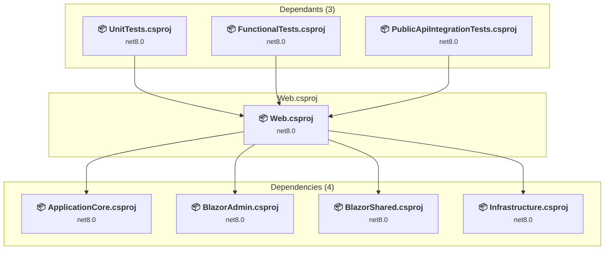

# src/Web/Web.csproj

[← Back to the assessment index](../../assessment.md)

## Project Info

- **Current Target Framework:** net8.0
- **Proposed Target Framework:** net10.0
- **SDK-style**: True
- **Project Kind:** AspNetCore
- **Dependencies**: 4
- **Dependants**: 3
- **Number of Files**: 185
- **Number of Files with Incidents**: 7
- **Lines of Code**: 4084
- **Estimated LOC to modify**: 15+ (at least 0.4% of the project)

## Related Projects

**Depends on (4)** — projects this one references:

- [/home/runner/work/eShopOnWeb/eShopOnWeb/src/ApplicationCore/ApplicationCore.csproj](../projects/ApplicationCore.md)
- [/home/runner/work/eShopOnWeb/eShopOnWeb/src/BlazorAdmin/BlazorAdmin.csproj](../projects/BlazorAdmin.md)
- [/home/runner/work/eShopOnWeb/eShopOnWeb/src/BlazorShared/BlazorShared.csproj](../projects/BlazorShared.md)
- [/home/runner/work/eShopOnWeb/eShopOnWeb/src/Infrastructure/Infrastructure.csproj](../projects/Infrastructure.md)

**Depended on by (3)** — projects that reference this one:

- [/home/runner/work/eShopOnWeb/eShopOnWeb/tests/FunctionalTests/FunctionalTests.csproj](../projects/FunctionalTests.md)
- [/home/runner/work/eShopOnWeb/eShopOnWeb/tests/PublicApiIntegrationTests/PublicApiIntegrationTests.csproj](../projects/PublicApiIntegrationTests.md)
- [/home/runner/work/eShopOnWeb/eShopOnWeb/tests/UnitTests/UnitTests.csproj](../projects/UnitTests.md)

## Dependency Graph

Legend:
📦 SDK-style project
⚙️ Classic project

## API Compatibility

| Category | Count | Impact |
| :--- | :---: | :--- |
| 🔴 Binary Incompatible | 5 | High - Require code changes |
| 🟡 Source Incompatible | 1 | Medium - Needs re-compilation and potential conflicting API error fixing |
| 🔵 Behavioral change | 9 | Low - Behavioral changes that may require testing at runtime |
| ✅ Compatible | 3231 |  |
| ***Total APIs Analyzed*** | ***3246*** |  |

## NuGet Package Issues

| Package | Current Version | Suggested Version | Severity | Issue |
| :--- | :---: | :---: | :---: | :--- |
| AutoMapper.Extensions.Microsoft.DependencyInjection | 12.0.1 | — | 🔵 Optional | NuGet package is deprecated |
| Azure.Identity | 1.10.4 | 1.21.0 | 🔵 Optional | NuGet package contains security vulnerability |
| Azure.Identity | 1.10.4 | — | 🔵 Optional | NuGet package is deprecated |
| Microsoft.AspNetCore.Authentication.JwtBearer | 8.0.2 | 10.0.12 | 🟡 Potential | NuGet package upgrade is recommended |
| Microsoft.AspNetCore.Components.WebAssembly.Server | 8.0.2 | 10.0.12 | 🟡 Potential | NuGet package upgrade is recommended |
| Microsoft.AspNetCore.Diagnostics.EntityFrameworkCore | 8.0.2 | 10.0.12 | 🟡 Potential | NuGet package upgrade is recommended |
| Microsoft.AspNetCore.Identity.EntityFrameworkCore | 8.0.2 | 10.0.12 | 🟡 Potential | NuGet package upgrade is recommended |
| Microsoft.AspNetCore.Identity.UI | 8.0.2 | 10.0.12 | 🟡 Potential | NuGet package upgrade is recommended |
| Microsoft.EntityFrameworkCore.InMemory | 8.0.2 | 10.0.12 | 🟡 Potential | NuGet package upgrade is recommended |
| Microsoft.EntityFrameworkCore.SqlServer | 8.0.2 | 10.0.12 | 🟡 Potential | NuGet package upgrade is recommended |
| Microsoft.EntityFrameworkCore.Tools | 8.0.2 | 10.0.12 | 🟡 Potential | NuGet package upgrade is recommended |
| Microsoft.VisualStudio.Web.CodeGeneration.Design | 8.0.0 | 10.0.2 | 🟡 Potential | NuGet package upgrade is recommended |
| System.IdentityModel.Tokens.Jwt | 7.3.1 | — | 🔵 Optional | NuGet package is deprecated |

Every project affected by these packages, and the versions the repository settles on: [aggregate NuGet packages](../nuget/aggregate-packages.md).

